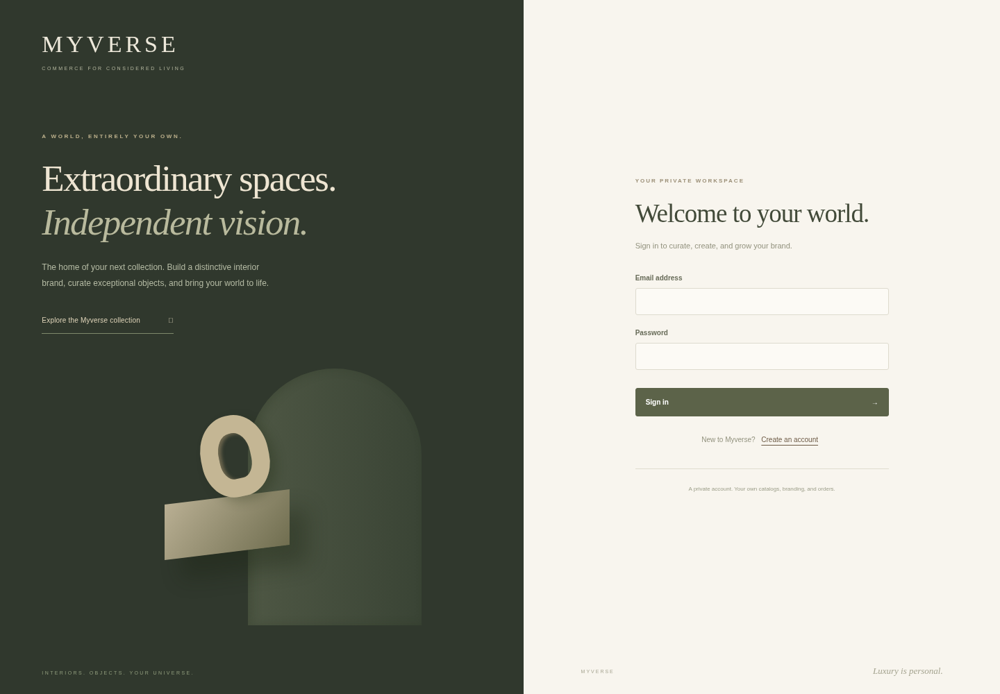
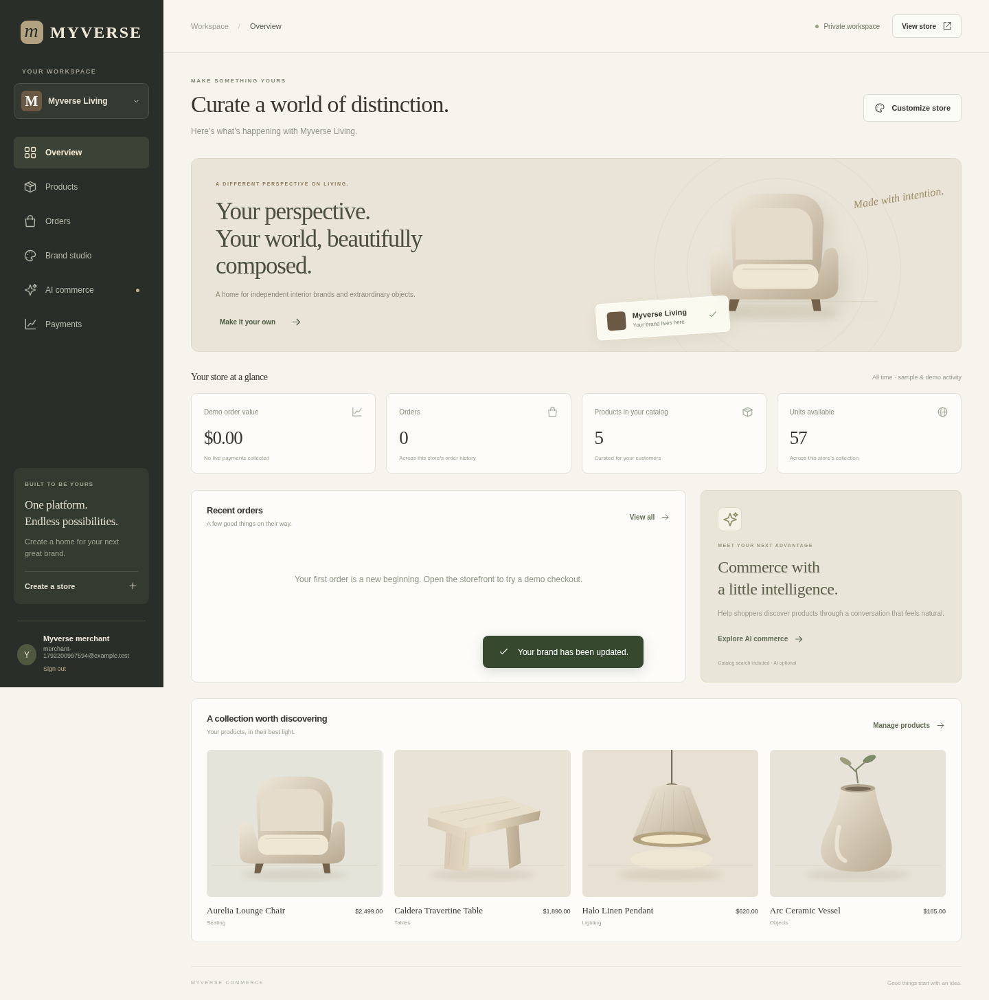
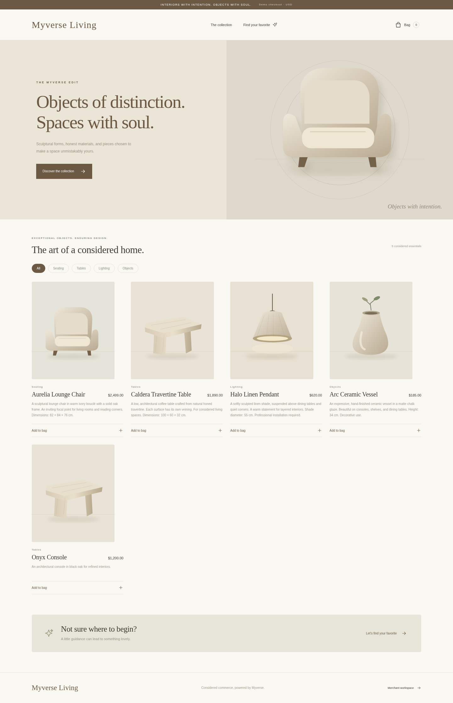

# Myverse app preview

**This page contains screenshots. Its navigation, products, and buttons are part of the images and cannot be clicked.**

To use the interactive application, follow [Run Myverse with Docker](../DOCKER.md). With Docker installed, clone the repository and run these commands from the app directory:

```sh
docker compose up -d --build --wait
docker compose ps
```

Open the application on port **8080** in a browser on the same computer running Docker. Register a merchant account to use the dashboard, or open `/store/myverse-atelier` in the running app to browse the sample storefront. A GitHub file page or screenshot is not the running application. Public access from another device requires a server and HTTPS domain as described in the Docker guide.

The screenshots below were captured from the running Myverse application using sample interior-decor products and a test merchant account. Open an image to enlarge it.

## Merchant sign-in



## Merchant dashboard



## Customer storefront



Without provider credentials, the running app uses catalog search and demo checkout; no payment is collected. OpenAI chat and live Stripe payments require the setup described in [deployment instructions](../DEPLOYMENT.md). Railway is optional.
